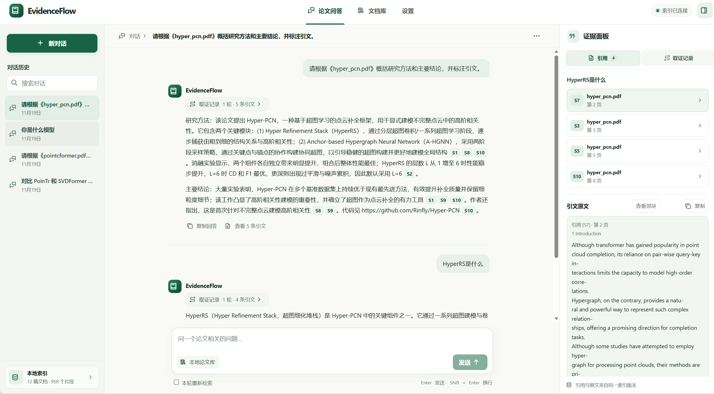

# EvidenceFlow

EvidenceFlow 是一个面向科研 PDF 的本地知识库和问答工作台。它从论文中检索原文证据，回答时给出可点击的引用和页码，便于回查。



- **论文入库**从有文字层的 PDF 提取正文，清洗后按章节和段落切块，再生成向量。
- **取证问答**先做向量召回，再用重排模型筛选证据。证据不足时，Agent 可以在预算内改写查询或补读原文。
- **WebUI** 显示真实搜索词、命中文档和原文片段，支持围绕单篇论文提问、复用会话证据。
- **增量更新**在已有正式索引的文档库中添加 PDF，页面显示入库进度。构建成功后自动发布，新文档随即可以检索。

## 快速开始

需要 Python 3.11 或更新版本、可访问此仓库的 GitHub 账号，以及 OpenAI 兼容的 LLM 服务。下面使用 Windows CMD 和 Conda。

### 1. 安装

```cmd
git clone https://github.com/AercherC/EvidenceFlow.git
cd EvidenceFlow
conda create -n evidenceflow python=3.11 -y
conda activate evidenceflow
python -m pip install -e ".[web]"
copy .env.example .env
```

打开 `.env`，填写 `LLM_API_KEY`。使用其他服务时，按服务商配置修改 `LLM_BASE_URL`、`LLM_MODEL` 和 `LLM_THINKING`。向量化和重排在本机运行，生成答案会调用你配置的 LLM 服务。

### 2. 准备模型和首批文档

首次部署时，联网把默认模型下载到项目缓存，再把有文字层的 PDF 放入 `data\source_docs`。

```cmd
set "HF_HOME=%CD%\.cache\huggingface"
hf download BAAI/bge-m3 --exclude "onnx/*"
hf download BAAI/bge-reranker-base config.json model.safetensors tokenizer.json tokenizer_config.json special_tokens_map.json sentencepiece.bpe.model
if not exist data\source_docs mkdir data\source_docs
```

放入 PDF 后，运行命令建立索引。

```cmd
python -m evidenceflow ingest
```

新环境可用这个命令建库，再在 WebUI 浏览和提问。界面里的「添加 PDF」需要已启用生命周期管理的正式索引。只用 `ingest` 建库的环境，可以继续在终端用该命令导入文档。

### 3. 启动 WebUI

```cmd
python -m evidenceflow.webui --host 127.0.0.1 --port 7860
```

打开 [http://127.0.0.1:7860](http://127.0.0.1:7860)，从文档库选一篇论文，试问「这篇论文解决了什么问题？作者用哪些实验支持结论？」点击引用可回到对应原文。

从项目根目录启动时，WebUI 默认从 `.cache\huggingface` 离线加载模型，日常启动只需运行上面的命令。

## 技术栈

- 文档解析使用 PyMuPDF、混合切块使用 BGE-M3 分词。
- 检索使用 BGE-M3、Chroma 和 BGE Reranker，WebUI 由 FastAPI 提供，会话证据使用 LangGraph 和 SQLite 保存。

索引生命周期和评测设计见 [项目规格](PROJECT_SPEC.md)。WebUI 的布局参考了 [SuperMew](https://github.com/icey1287/SuperMew)。
